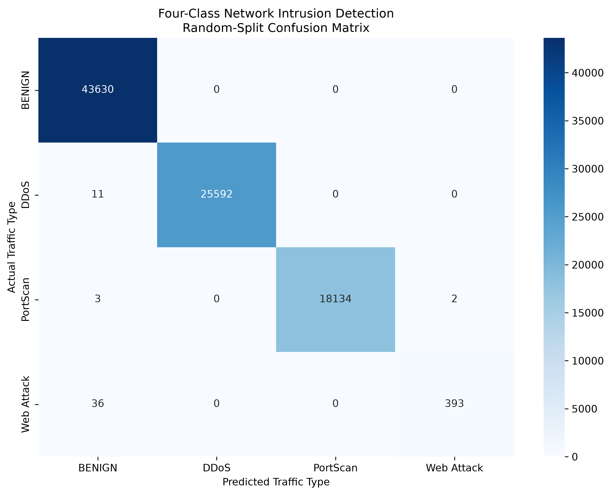

# Network Traffic Classifier — Model Evaluation

## Project Overview

This project uses machine learning to classify network traffic from the CIC-IDS2017 dataset into four categories:

- BENIGN
- DDoS
- PortScan
- Web Attack

The final candidate model is a Random Forest classifier trained using 78 network-flow features.

## Dataset

The four-class dataset contains 439,002 cleaned records:

| Traffic Class | Records |
|---|---:|
| BENIGN | 218,151 |
| DDoS | 128,014 |
| PortScan | 90,694 |
| Web Attack | 2,143 |

The Web Attack class combines Brute Force, XSS, and SQL Injection records.

## Model Configuration

- Algorithm: Random Forest
- Number of trees: 100
- Maximum tree depth: 10
- Class weighting: None
- Random state: 42
- Train/test split: 80% / 20%, stratified
- Features: 78

## Random-Split Evaluation

**Overall accuracy: 99.9408%**

| Class | Precision | Recall |
|---|---:|---:|
| BENIGN | 99.89% | 100.00% |
| DDoS | 100.00% | 99.96% |
| PortScan | 100.00% | 99.97% |
| Web Attack | 99.49% | 91.61% |

The model correctly identified 393 of 429 Web Attack flows in the test partition and missed 36.

### Confusion Matrix

## Cross-Day Benign Traffic Evaluation

The final candidate model was also tested on benign traffic from other captures.

| Dataset | Benign Flows | False Alarms | False-Positive Rate |
|---|---:|---:|---:|
| Monday | 529,481 | 138 | 0.0261% |
| Thursday | 168,051 | 36 | 0.0214% |

Monday is a separate capture day. Thursday's benign records were excluded from training, but the model was trained on Web Attack records from the same Thursday capture.

These results measure false-positive behavior on benign traffic, not attack detection performance on independent captures.

## Class Weighting Experiment

Two four-class Random Forest models were compared.

| Metric | Balanced Subsample | No Class Weight |
|---|---:|---:|
| Overall accuracy | 99.9055% | 99.9408% |
| Web Attack precision | 86.79% | 99.49% |
| Web Attack recall | 99.53% | 91.61% |
| Monday false alarms | 625 | 138 |

The unweighted model was selected provisionally because it produced substantially fewer false alarms on Monday, while maintaining useful Web Attack recall on the random test split.

## Limitations

1. The random train/test split contains records from the same captures, which can produce optimistic performance estimates due to correlated traffic.
2. Exact duplicate checks do not rule out near-duplicate flows or capture-specific patterns.
3. The Web Attack class contains relatively few records, particularly SQL Injection examples.
4. The model has not been validated for attack detection on a fully independent capture containing the same four classes.
5. Monday was used repeatedly during model comparison, so it should be considered a development benchmark rather than an untouched final test set.
6. The classifier is not a production-ready intrusion detection system.

## Conclusion

The project demonstrates an end-to-end machine-learning workflow for network traffic classification, including preprocessing, feature analysis, model comparison, class-imbalance experiments, confusion matrix visualization, and cross-day benign traffic evaluation.

The final candidate model achieves 99.9408% accuracy on a random within-dataset test split and a 0.0261% false-positive rate on Monday's benign traffic.

Further evaluation using independent attack-containing captures is required before making claims about real-world intrusion detection performance.