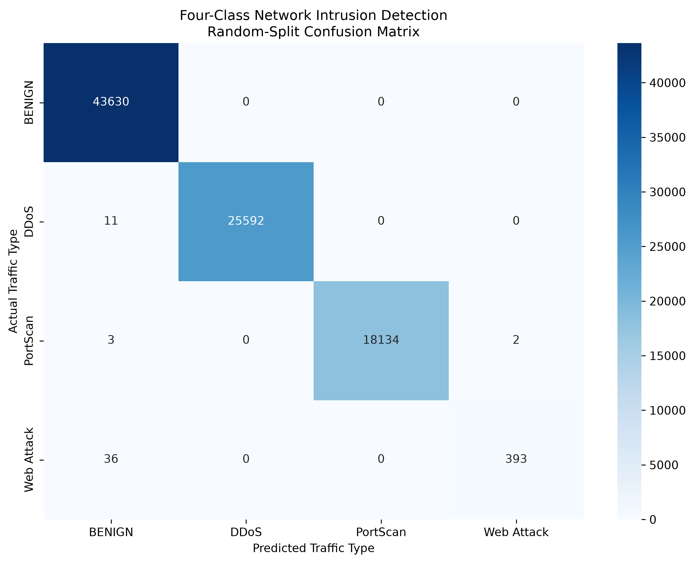
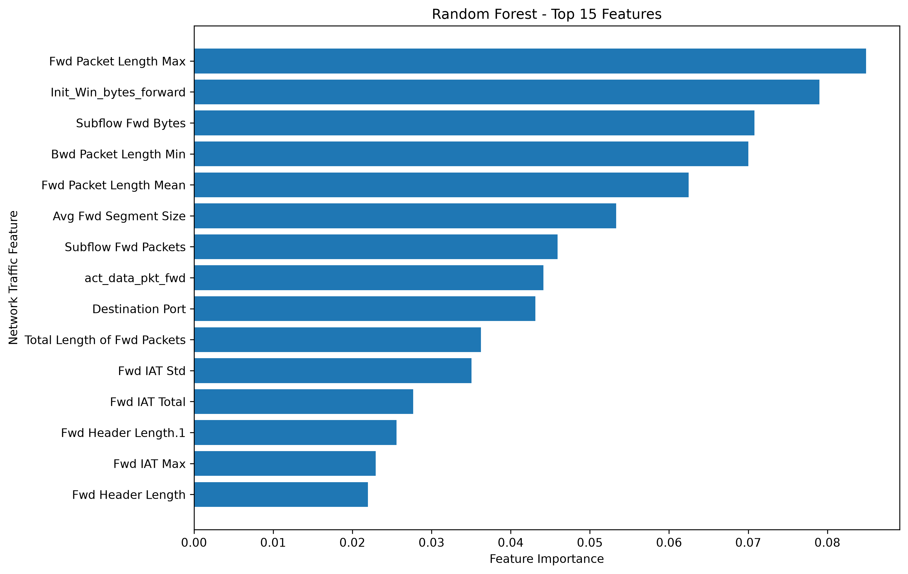

# Network Traffic Classifier

**Machine Learning-Based Network Intrusion Detection System (NIDS)**

A cybersecurity and machine learning project that uses Python, Scikit-learn, and the CIC-IDS2017 dataset to classify network traffic and identify known attack patterns.

The project explores model performance, class imbalance, false positives, feature importance, and generalization to previously unseen attack categories.

## Project Overview

The final experimental model classifies network flows into four categories:

| Label | Traffic Type |
|---|---|
| 0 | BENIGN |
| 1 | DDoS |
| 2 | PortScan |
| 3 | Web Attack |

The Web Attack category combines Brute Force, Cross-Site Scripting (XSS), and SQL Injection traffic.

### Key Features

- Network traffic cleaning and preprocessing
- Decision Tree and Random Forest classifiers
- Binary, three-class, and four-class classification
- Feature importance analysis
- Class weighting experiments
- Duplicate and potential data leakage investigations
- Cross-day benign traffic evaluation
- Confusion matrix visualization
- Model serialization using Joblib

## Technologies Used

| Category | Technologies |
|---|---|
| Programming Language | Python 3.12 |
| Machine Learning | Scikit-learn |
| Data Processing | Pandas, NumPy |
| Visualization | Matplotlib, Seaborn |
| Model Serialization | Joblib |
| Development Environment | VS Code |
| Version Control | Git, GitHub |

## Dataset

This project uses the **CIC-IDS2017 dataset**, published by the Canadian Institute for Cybersecurity at the University of New Brunswick.

Official dataset: https://www.unb.ca/cic/datasets/ids-2017.html

The prepared four-class dataset contains **439,002 network-flow records** and **78 numerical features**.

### Dataset Distribution

| Traffic Type | Records |
|---|---:|
| BENIGN | 218,151 |
| DDoS | 128,014 |
| PortScan | 90,694 |
| Web Attack | 2,143 |
| **Total** | **439,002** |

The dataset combines selected Friday DDoS and PortScan captures with Web Attack records from Thursday.

The `Source` column is retained as metadata but excluded from model training.

## Machine Learning Models

Several models were developed and evaluated:

1. Binary Decision Tree — BENIGN vs DDoS
2. Binary Random Forest — BENIGN vs DDoS
3. Three-Class Random Forest — BENIGN, DDoS, PortScan
4. Four-Class Random Forest — BENIGN, DDoS, PortScan, Web Attack

### Selected Experimental Model

The selected model is an **unweighted four-class Random Forest classifier**.

| Parameter | Value |
|---|---|
| Algorithm | Random Forest |
| Number of Trees | 100 |
| Maximum Depth | 10 |
| Class Weight | None |
| Random State | 42 |
| Training Split | 80% |
| Testing Split | 20% |
| Split Strategy | Stratified Random Split |
| Input Features | 78 |

Model output: `models/four_class_unweighted.pkl`

## Model Performance

### Four-Class Classification Results

**Overall Test Accuracy: 99.9408%**

| Traffic Type | Precision | Recall |
|---|---:|---:|
| BENIGN | 99.89% | 100.00% |
| DDoS | 100.00% | 99.96% |
| PortScan | 100.00% | 99.97% |
| Web Attack | 99.49% | 91.61% |

The model correctly identified **393 out of 429 Web Attack flows** in the random test partition.

These results were obtained from a stratified random split within the same captures and may overestimate performance on independent network traffic.

### Confusion Matrix

The confusion matrix below visualizes predictions across all four traffic categories.



### Cross-Day Benign Traffic Evaluation

The model was also tested against benign traffic from Monday and Thursday.

| Dataset | Benign Flows | False Alarms | False-Positive Rate |
|---|---:|---:|---:|
| Monday | 529,481 | 138 | 0.0261% |
| Thursday | 168,051 | 36 | 0.0214% |

Monday provides a different-day benign traffic evaluation.

Thursday's benign records were excluded from training, but Web Attack records from the same Thursday capture were used for training. Therefore, Thursday is not a fully independent capture-level evaluation.

These tests evaluate false alarms on benign traffic rather than detection performance on independent attack-containing captures.

## Feature Importance

Random Forest feature importance was analyzed to identify network-flow characteristics contributing to classification.

Examples of important features include:

- Fwd Packet Length Max
- Init_Win_bytes_forward
- Subflow Fwd Bytes

### Feature Importance Visualization



The feature importance visualization was generated during the earlier binary Random Forest experiment and does not represent a separate importance analysis of the selected four-class model.

## Class Weighting Experiment

Two four-class Random Forest configurations were compared:

- Balanced subsample class weighting
- No class weighting

| Metric | Balanced | Unweighted |
|---|---:|---:|
| Random-Split Accuracy | 99.9055% | 99.9408% |
| Web Attack Precision | 86.79% | 99.49% |
| Web Attack Recall | 99.53% | 91.61% |
| Monday False Alarms | 625 | 138 |
| Monday False-Positive Rate | 0.1180% | 0.0261% |

The balanced model achieved higher Web Attack recall but generated more false alarms.

The unweighted model was selected provisionally because it produced fewer false alarms on Monday while retaining strong performance on the random test split.

## Unseen Attack Experiment

Before adding Web Attack examples to training, the three-class model was tested on Thursday's Web Attack traffic.

| Metric | Result |
|---|---:|
| Web Attack Flows Tested | 2,180 |
| Flows Flagged as Attacks | 0 |
| Flagged Rate | 0.00% |

This experiment highlighted a major limitation: high classification accuracy on known traffic categories does not guarantee detection of previously unseen attack types.

## Project Structure

```text
network-traffic-classifier/
├── data/
├── models/
├── results/
│   ├── feature_importance.csv
│   ├── feature_importance.png
│   ├── four_class_confusion_matrix.png
│   └── traffic_visualization.png
├── src/
│   ├── clean_data.py
│   ├── prepare_multiclass.py
│   ├── prepare_four_class.py
│   ├── train_model.py
│   ├── train_random_forest.py
│   ├── train_multiclass.py
│   ├── train_four_class.py
│   ├── compare_class_weights.py
│   ├── test_unweighted_monday.py
│   ├── test_unweighted_thursday.py
│   ├── feature_importance.py
│   ├── leakage_check.py
│   ├── check_duplicates.py
│   └── visualize_four_class.py
├── .gitignore
├── README.md
└── EVALUATION.md
```

Additional exploratory and evaluation scripts are included in the `src` directory.

Large datasets and trained model binaries are excluded from GitHub using `.gitignore`.

## Installation

### 1. Clone the Repository

```powershell
git clone https://github.com/1kab1/network-traffic-classifier.git
cd network-traffic-classifier
```

### 2. Create a Virtual Environment

```powershell
py -3.12 -m venv .venv
```

### 3. Activate the Environment

For Windows PowerShell:

```powershell
.\.venv\Scripts\Activate.ps1
```

### 4. Install Dependencies

```powershell
python -m pip install -r requirements.txt
```

## Running the Project

### 1. Download the Dataset

Download the CIC-IDS2017 MachineLearningCSV dataset from:

https://www.unb.ca/cic/datasets/ids-2017.html

Place the required CSV files inside the `data` directory.

The project uses:

- Friday afternoon DDoS traffic
- Friday afternoon PortScan traffic
- Thursday morning Web Attack traffic
- Monday Working Hours traffic

The preparation scripts expect cleaned input files from the project's preprocessing workflow.

### 2. Prepare the Multiclass Dataset

```powershell
python src/prepare_multiclass.py
```

### 3. Prepare the Four-Class Dataset

```powershell
python src/prepare_four_class.py
```

### 4. Train the Selected Model

```powershell
python src/test_unweighted_monday.py
```

This script trains the unweighted Random Forest, saves it to `models/four_class_unweighted.pkl`, and evaluates benign Monday traffic.

### 5. Evaluate Thursday Traffic

```powershell
python src/test_unweighted_thursday.py
```

### 6. Generate the Confusion Matrix

```powershell
python src/visualize_four_class.py
```

The confusion matrix is saved to `results/four_class_confusion_matrix.png`.

## Key Findings

- Random Forest achieved high classification accuracy on within-dataset random splits.
- Adding Web Attack examples allowed the classifier to recognize an additional attack category.
- Class weighting improved Web Attack recall but increased false alarms.
- Removing class weighting reduced Monday false alarms from 625 to 138.
- The selected unweighted model achieved 91.61% Web Attack recall on the random test split.
- Testing against previously unseen attacks exposed limitations in model generalization.

## Limitations

1. Random splitting may overestimate performance when related network flows appear in both training and testing partitions.
2. Exact duplicate checks do not eliminate all possible data leakage.
3. Web Attack examples are relatively scarce, especially SQL Injection records.
4. Attack detection has not been validated on a fully independent attack-containing capture.
5. Monday was used during model comparison and is not an untouched final test set.
6. Thursday's benign traffic shares its capture with Web Attack training records.
7. This project is an educational machine-learning prototype, not a production-ready intrusion detection system.

## Future Improvements

- Capture-aware training and evaluation
- Independent attack-containing test datasets
- Additional attack categories
- Hyperparameter tuning
- Precision-recall and threshold analysis
- Explainable AI and feature interpretation
- Interactive monitoring dashboard
- Flask or FastAPI deployment
- Docker containerization

## Detailed Evaluation

For additional model comparisons, experiments, and limitations, see:

[Model Evaluation Report](EVALUATION.md)

## Author

**1kab1**

Machine Learning | Python | Cybersecurity

GitHub: https://github.com/1kab1